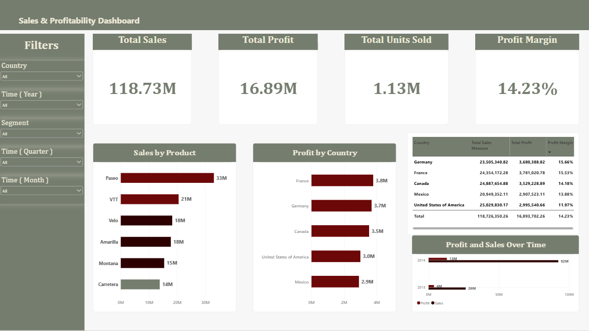

# Sales & Profitability Dashboard — Power BI

An interactive Power BI dashboard built to analyze sales and profitability across countries, products, and time periods using Microsoft's Financial Sample dataset.

## Dashboard Preview

## Project Objectives

- Analyze overall sales and profit performance.
- Compare sales and profitability across countries.
- Identify products with the highest and lowest sales.
- Explore changes in sales and profit over time.
- Present key performance indicators in an interactive dashboard.

## Tools & Technologies

- Microsoft Power BI Desktop
- Microsoft Excel
- DAX (Data Analysis Expressions)

## Key Performance Indicators

| KPI | Value |
|---|---:|
| Total Sales | 118.73M |
| Total Profit | 16.89M |
| Total Units Sold | 1.13M |
| Profit Margin | 14.23% |

*Values are rounded and represent the unfiltered report. Monetary values follow the source dataset.*

## Dashboard Features

- KPI cards for sales, profit, units sold, and profit margin.
- Sales and profit analysis over time.
- Sales comparison by product.
- Sales and profit comparison by country.
- Country-level table with sales, profit, and profit margin.
- Interactive filters for country, year, segment, and month.

## Key Findings

1. The United States recorded the highest total sales among the countries in the report.
2. France recorded the highest total profit.
3. Germany achieved the highest profit margin at approximately 15.66%.
4. Paseo recorded the highest product sales, while Carretera recorded the lowest.
5. Both sales and profit were higher in 2014 than in 2013.

These findings describe patterns in the dataset; they do not establish the underlying causes of differences in performance.

## How to Use

1. Download `Sales-Profitability-Dashboard.pbix` from this repository.
2. Open the file using Power BI Desktop.
3. Use the available filters to explore the data by country, year, segment, and month.

## Data Source

Microsoft Financial Sample dataset:

[Download the Financial Sample dataset](https://download.microsoft.com/download/1/4/E/14EDED28-6C58-4055-A65C-23B4DA81C4DE/Financial%20Sample.xlsx)

## Project Status

Completed the initial dashboard build; final portfolio review and documentation are in progress.
